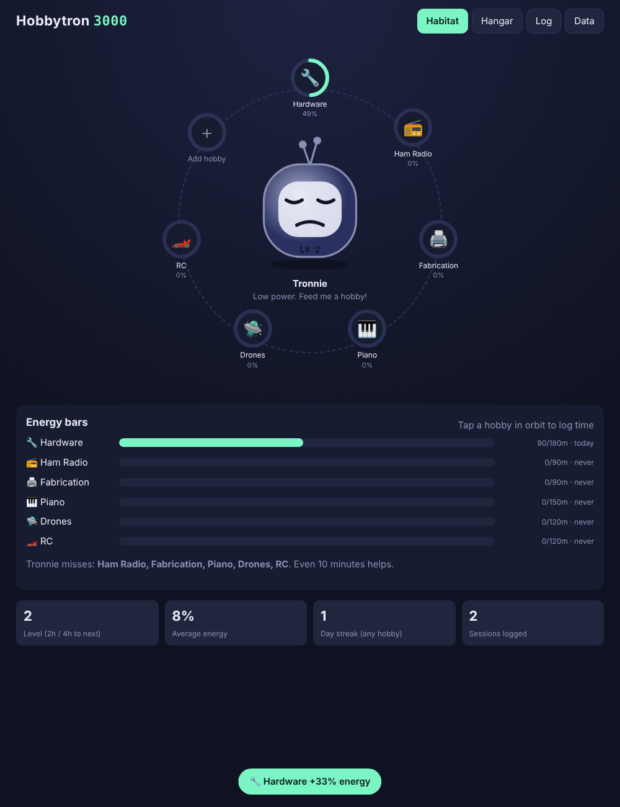
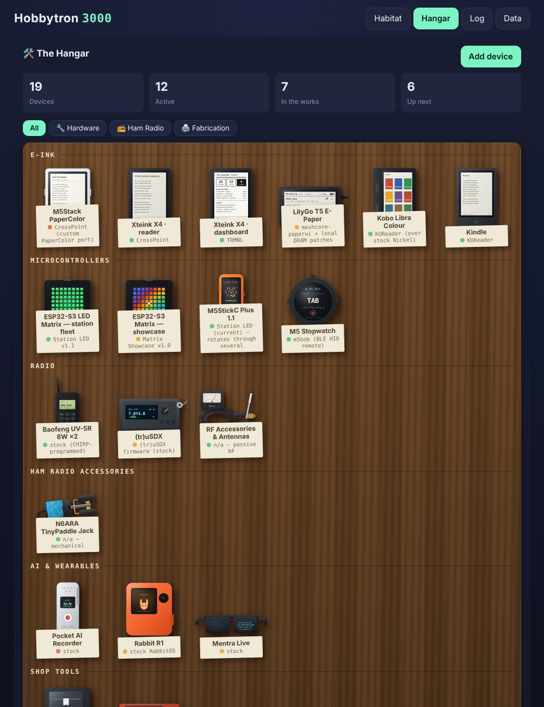

# Hobbytron 3000



A hobby tamagotchi. Your creature sits in the middle of a "habitat" with every hobby orbiting around it. Log time on a hobby and its energy ring fills; skip it and the energy slowly drains (about a one-week decay). Keep all your hobbies charged and the creature is happy; let them all fade and it goes to sleep.

## Features

- **Habitat**: the creature plus orbiting hobby rings. Tap a hobby to log a session. Neglected hobbies pulse.
- **Energy bars**: per-hobby energy versus a weekly minutes goal, minutes this week, and when you last did it.
- **Levels**: the creature levels up with total lifetime hours and grows an extra antenna per level (up to 5).
- **Hangar**: the full hardware fleet imported from [The Hangar](https://claude.ai/artifact/LUBUXLJSEkgiBoxzNfSJ5N): hand-drawn SVG flat-lay on a walnut desk, with each device's story, highlights and firmware history. Every device feeds a hobby (e-ink, microcontrollers and AI gadgets → Hardware; radios and the CW paddle → Ham Radio; the Bambu and xTool → Fabrication).
  - **Log bench time** on a device to feed its hobby's energy.
  - **Log firmware flash** to add to the firmware history and log the bench time in one step.
  - Add your own gear (drones, RC, piano...) with an emoji in place of art, and track the "What's next" idea board.
- **Log**: add, edit or delete hobbies (name, emoji, color, weekly goal) and review recent sessions.
- **Data**: export and import JSON backups. Everything is stored in your browser's localStorage.

Starter hobbies: Hardware, Ham Radio, Fabrication, Piano, Drones and RC. Add more from the `＋` node.



## Running

No build step and no dependencies. Open `index.html` in a browser, or serve the folder:

```sh
python3 -m http.server 8000
```

It also works on GitHub Pages as-is.

## Hangar data

`hangar/fleet.js` is the fleet data and device SVGs from The Hangar artifact. It seeds the Hangar tab the first time the app loads. After that, your edits live in localStorage, so use **Data → Export** to back them up.

## How energy works

Each session adds `minutes × e^(−days_ago / 7)` to its hobby's energy. Energy % is that total divided by the hobby's weekly goal, capped at 100%. If you hit your weekly goal at a steady pace, the hobby sits near 100%.
